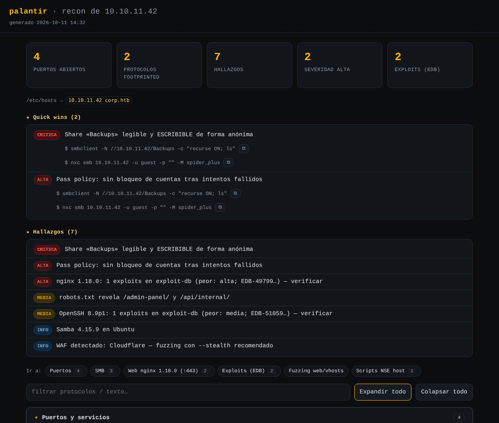

# palantir

[](https://github.com/salitress/palantir/actions/workflows/selftest.yml)
[](LICENSE)
[](README.md)

Scanner de reconocimiento guiado por Nmap para labs (HTB / CPTS). ve puertos, servicios, **footprinting por protocolo**, **exploits conocidos** y superficie web antes de tocar nada. **Educativo**: imprime cada comando que lanza con su *por qué*, en pantalla y en el informe HTML. Python 3, **solo stdlib** en el núcleo; herramientas externas **opcionales** (se saltan solas si no están): `nmap` (obligatorio), `ffuf` (fuzzing web), `searchsploit` (exploits conocidos), y para el footprinting: `nxc`/`netexec` (SMB, LDAP, WinRM, RDP, VNC, WMI, MSSQL, NFS), `smbclient`/`rpcclient`/`smbmap`/`enum4linux-ng`, `impacket-rpcdump`, `showmount`, `dig`, `whois`, `crt.sh` (Certificate Transparency), `ldapsearch`, `whatweb`, `wafw00f`, `snmpwalk`/`onesixtyone`, `tnscmd10g`, `redis-cli`, `certipy` (AD CS: plantillas de certificados vulnerables), `impacket-GetNPUsers`/`GetUserSPNs` (AS-REP roast / Kerberoasting), `adidnsdump` (DNS interno vía LDAP). Pensado para Kali.

## Índice

[Vista previa](#vista-previa) · [Resumen rápido](#resumen-rápido) · [Qué hace (por fases)](#qué-hace-por-fases) · [Requisitos](#requisitos) · [Uso](#uso) · [Flags](#flags) · [Notas](#notas)

## Vista previa



*Ejemplo ilustrativo (datos ficticios, generado para este README) — así se ve `report.html` tras un escaneo real: tarjetas de resumen arriba, **★ Quick wins** con botón de copiar en cada comando, hallazgos ordenados por severidad, e índice **"Ir a:"** para saltar a cada protocolo.*

## Resumen rápido

Si solo vas a leer una sección, esta.

```bash
sudo ./palantir.py 10.129.21.27          # recon completo por defecto (ver abajo qué incluye)
```

Las flags que más se usan en el día a día (la tabla completa está en [Flags](#flags)):

| Flag | Para qué |
|---|---|
| `target` | IP, CIDR, rango o hostname — el único argumento obligatorio. |
| `sudo` | SYN scan (`-sS`) + UDP. Sin root, cae solo a connect scan (`-sT`), más lento. |
| `--top` | Solo top-1000 puertos en vez de los 65535 — mucho más rápido para un primer vistazo. |
| `--no-aggressive` | Sin scripts `vuln` ni footprint profundo — más rápido y silencioso. |
| `--stealth` | Modo sigiloso (más lento, menos ruidoso) — para labs de evasión. |
| `--tunnel` (`--pivoting`) | Escaneo a través de un pivot/túnel (ligolo-ng, chisel, SOCKS…): `-sT` + timing que no inunda el túnel (sin `--min-rate`, más reintentos) para no perder puertos. Mucho más rápido que `--stealth`. |
| `--resume` | Reutiliza el escaneo nmap ya hecho y, si los puertos no cambiaron, el footprint/searchsploit/creds por defecto del run anterior (no los repite) — solo relanza fuzzing/informes y las credenciales aportadas nuevas. Para iterar rápido. |
| `--vhost DOMINIO` / `--vhost-names LISTA` | Fuzzing de subdominios, o directo a confirmar si ya los conoces. |
| `--port PUERTOS` | Cuando ya sabes el puerto (p. ej. un lab de HTB Academy) — evita barrer todo. |
| `--default-creds` | SOLO credenciales por defecto verificadas, nada más — rápido y dirigido. |
| `--jobs N` | Varios objetivos en paralelo (un `/24`, una lista grande). |
| `-o DIR` | Carpeta de resultados (def. `~/htb`). |
| `--selftest` | Prueba el propio script sin tocar la red — útil para comprobar que todo sigue intacto. |

Más ejemplos copia-pega en [Uso](#uso).

## Qué hace (por fases)

0. **Ping-sweep** (CIDR/rangos, `nmap -sn`, un solo proceso) — barre primero quién está vivo y descarta del resto del run las IPs que no respondieron (una `/24` con 50 vivas ahorra 200 escaneos `-p-` completos sobre hosts muertos). Solo poda IPs que SALEN de un CIDR/rango; una IP suelta o un hostname escritos a mano se escanean siempre (una box de HTB no responde a ping, por eso el resto va con `-Pn`). `--no-sweep` lo desactiva (hosts que bloquean ICMP). **Se desactiva sola con `--tunnel`** (ver más abajo): ICMP no atraviesa un pivot/SOCKS, así que intentarlo ahí daría "todos muertos" en vez de podar de verdad.
1. **Descubrimiento de puertos** — barrido rápido de todos los puertos (`-p- --min-rate --max-retries 2 --open`). Con `--top`, solo top-1000.
2. **Enumeración** — `-sV` + una lista curada de scripts NSE **seguros** sobre los puertos abiertos (Nmap enruta cada script a su servicio por su portrule), con `--script-timeout`. Con `--aggressive` se lanza un **segundo nmap aparte** con los scripts `vuln`/backdoor (heartbleed, ms17-010, shellshock…), de modo que si uno se cuelga y salta su timeout **no se pierden los resultados seguros**. Sin `dos`/`unsafe`, sin `vulners` (no manda datos fuera).
3. **UDP** (opcional, `--udp`, requiere root) — barrido de los puertos UDP que importan (SNMP 161, TFTP 69, NTP 123, IPMI 623, DNS 53…) con `-sV --version-intensity 0`. Va aquí, justo tras la Fase 2 y antes del banner grabbing/footprinting, para que si aparece SNMP o IPMI por UDP, la Fase 5 ya los tenga disponibles.
4. **Banner grabbing manual** — socket propio a cada puerto abierto; caza servicios que Nmap deja como `unknown` (p. ej. un FTP en 31337 que responde `220 ...`). El sondeo HTTP `HEAD` solo se manda a puertos web.
5. **Footprinting por protocolo** — para cada servicio reconocido lanza la enumeración manual que enseña el path de Footprinting del CPTS, **solo lectura y credenciales por defecto** (anónimo / null / guest / `Administrator` sin contraseña / `sa` sin contraseña / `public`): **un solo intento por cuenta**, nada de fuerza bruta de contraseñas ni escritura en el objetivo. Cada comando se imprime con su **por qué**. Los protocolos de `nxc` comparten un **fallback de credenciales por defecto** (`null → guest → Administrator`) y `(Pwn3d!)` se marca como hallazgo crítico. En una línea, por protocolo:

   | Protocolo / puerto | Qué hace |
   |---|---|
   | FTP | Login anónimo + listado (`ftplib`); **mod_copy** (ProFTPD, CVE-2015-3306: `SITE CPFR` sin auth → RCE, solo lectura) y **FTP bounce** (NSE `ftp-bounce`). |
   | SMB / RPC | `smbclient`/`rpcclient` null-session (incl. **`enumdomgroups` + membresía** de Domain Admins/grupos custom por SAMR, sin credenciales), `nxc` con fallback, spidering de shares legibles (contenido con `--spider`); **Zerologon** (CVE-2020-1472, sin credenciales), **SMB signing no requerido** (superficie de NTLM relay, combinado con MSRPC) y enum AD si es DC **y** entra sesión. Con `-u/-p/-H` (Fase 5d) enumera CON la credencial + **`--loggedon-users`** + **GPP cpassword** en SYSVOL + **noPac** (CVE-2021-42278/42287, cuenta de dominio estándar → Domain Admin). |
   | LDAP | `nxc` con fallback (si entra el bind) + `ldapsearch` naming contexts/**trusts de dominio-bosque**/**MachineAccountQuota** (`-M maq`). Con credencial (Fase 5d): usuarios/grupos/roasting + **LAPS** (admin local) + `certipy find` (AD CS, plantillas vulnerables) + **DCSync-rights** (hash de krbtgt si hay derechos de réplica) + **adidnsdump** (DNS interno vía LDAP) + MAQ/trusts también con credencial. |
   | WinRM / RDP / VNC / WMI | `nxc` con fallback de credenciales por defecto. |
   | MSSQL | `nxc` con `sa` sin contraseña → `xp_cmdshell`. |
   | NFS | `showmount` + `nxc nfs --shares`. |
   | DNS | AXFR + `dig any`; WHOIS, Certificate Transparency (`crt.sh`) y DNS pasivo (hackertarget.com) si hay dominio. |
   | Kerberos / Docker API | Corrobora DC + **enum de usuarios por Kerberos** (`kerbrute userenum`, no bloquea cuentas) si hay dominio y, con **`--spray PASS`**, **password spraying automático** (`kerbrute passwordspray --safe`) contra los usuarios descubiertos / API sin auth → RCE trivial si responde. |
   | SMTP | `EHLO`+`VRFY`, enum de usuarios/open relay. |
   | IMAP / POP3 / SSH | Banner/algoritmos + siguientes pasos. |
   | SNMP | `snmpwalk` + walk a OIDs jugosos; brute de community con `--aggressive`. |
   | Web / IIS | `whatweb`+`wafw00f`+chequeos de ficheros sensibles + cabeceras de seguridad ausentes (HSTS/CSP/X-Frame-Options/X-Content-Type-Options); `--nikto`/`--cms-scan`/`--crawl`/`--nuclei` opt-in. |
   | MySQL / PostgreSQL / Oracle / IPMI / Redis / rsync | NSE + siguientes pasos. |
   | Elasticsearch / CouchDB / Memcached | Acceso sin autenticación. |
   | AJP / RMI / MongoDB / Telnet / TFTP / NTP | Siguientes pasos de explotación / NSE. |
   | Finger / IPP-CUPS / X11 / git daemon | Usuarios sin auth (`finger`) / versión CUPS (cadena CVE-2024-47176) / display abierto `xhost +` (screenshot-keylogging) / repos exportados clonables sin auth. |

   <details>
   <summary><b>Detalle completo por protocolo</b> (clic para expandir)</summary>

   - **FTP** → login anónimo + `LIST` (vía `ftplib`, sin binario externo; funciona donde `ftp-anon` de nmap falla con FTP no estándar).
   - **SMB / RPC** → `smbclient -N -L`, `rpcclient` null-session, `nxc smb --shares` con fallback null/guest/Administrator; **spidering de shares legibles** (`smbclient recurse ON; ls`, solo lectura) que marca ficheros jugosos (claves, configs, GPP `Groups.xml`, backups, flags…); si es **Domain Controller** (Kerberos/LDAP), **Zerologon** (`nxc smb -M zerologon`, CVE-2020-1472, **sin credenciales**, contra cualquier DC — comprueba, no explota; si sale VULNERABLE suele ser el camino más corto a Domain Admin del run) y, **si entró alguna sesión anónima** (null/guest), **enum AD de solo lectura**: `--rid-brute` (usuarios por IPC$) y, **solo si esa sesión devuelve datos de verdad** (el RID cycling saca usuarios, o el `--shares` ya mostró un share legible), `--users`, `--computers`, `--pass-pol` (longitud mínima, complejidad, historial y bloqueo quedan **siempre** como hallazgo `info` — antes solo generaba hallazgo si el lockout era débil — y avisa aparte si no hay bloqueo de cuentas). Sin `nxc`/`netexec` instalado, `rpcclient getdompwinfo` (añadido a la cadena de `rpcclient` de más arriba, sin coste extra) saca al menos longitud mínima + complejidad por sesión nula. Esa misma cadena de `rpcclient` por sesión nula también lanza **`enumdomgroups`** y, si es DC, para los grupos de **alto valor** (Domain/Enterprise/Schema Admins, GPO Creators) y los **personalizados** del dominio (RID≥1000, p. ej. `Interns`), consulta su **membresía** con `querygroupmem` y resuelve los RIDs de los miembros a nombres con los que ya dio `enumdomusers`/`enumdomgroups` (sin más llamadas): saber **quién es Domain Admin** sin credenciales — ni el RID cycling de `nxc` ni el `enumdomusers` suelto lo sacaban. Un DC moderno **acepta** la sesión nula/anónima (`[+]`) pero luego **deniega cada lectura** (RestrictAnonymous): en ese caso `[+]` solo significa "sesión aceptada", no "autorizado", así que palantir no insiste con `--users/--computers/--pass-pol` (devolverían lo mismo: nada) y deja indicado que hacen falta credenciales. Si null/guest **no** entran, igual. **SMB signing**: se lee del banner de `nxc` (que SIEMPRE lo imprime, incluso si el login falla) — si NO es requerido, hallazgo `media`; si además MSRPC (ver más abajo) confirma un primitivo de coacción (MS-RPRN/PrinterBug o MS-EFSR/PetitPotam) en el MISMO host, palantir escala a hallazgo CRÍTICO de **relay reflexivo**: coaccionar al equipo a autenticarse contra un listener propio y reenviar esa misma autenticación de vuelta a SU PROPIO SMB con `ntlmrelayx` da una sesión como la cuenta de MÁQUINA del equipo, sin crackear ni robar ninguna contraseña (la combinación se hace tras el footprint completo, en `run_one`, para que funcione igual en fresco que tras `--resume`). Con **`--spider`**, spidering de **contenido** (`nxc --spider SHARE --content`, grep dentro de los ficheros) de los shares legibles. Con `--aggressive`, `enum4linux-ng -A`. Con una credencial de dominio (Fase 5d, ver más abajo) también busca **GPP cpassword** en SYSVOL (`-M gpp_password`/`gpp_autologin`, MS14-025: contraseñas de GPO antiguas cifradas con una clave AES que Microsoft publicó) y comprueba **noPac** (`-M nopac`, CVE-2021-42278/42287: con CUALQUIER cuenta de dominio, sin necesitar admin, confirma si el DC deja suplantar a un Domain Admin).
   - **LDAP** → `nxc ldap` con fallback: `--users` es la **sonda**, y `--groups`/`--pass-pol`/`-M get-desc-users`/**`-M maq`** solo se lanzan **si ese `--users` devuelve usuarios** (un bind anónimo que el DC acepta pero no autoriza a leer no devuelve nada — entonces se indica que hacen falta credenciales, sin insistir con flags que darían lo mismo) + `ldapsearch` naming contexts/**trusts**. **MachineAccountQuota** (`-M maq`): si MAQ>0 (el valor por defecto de Microsoft es 10), CUALQUIER cuenta de dominio puede crear cuentas de máquina — precondición de noPac/RBCD/Shadow Credentials (hallazgo alta); MAQ=0 es el endurecimiento recomendado (info). **Trusts de dominio/bosque**: `nxc` NO tiene un flag `--trusts` para ldap (confirmado leyendo su código fuente — el método existe pero ningún argumento de CLI lo invoca), así que palantir usa `ldapsearch` (mismo base DN que `namingContexts`, SOLO LECTURA): dirección, tipo y si el trust cruza TODO el bosque del partner (clave para el alcance de un ataque extra-SID/cross-forest Kerberoasting). Con credencial (Fase 5d) se repiten los dos, MAQ igual por `nxc` y los trusts con un bind simple de `ldapsearch` (`-D usuario@dominio -y FICHERO` — SOLO con secreto en claro, nunca con `-H`/hash, y la contraseña nunca en el argv). **`-M get-desc-users`** busca contraseñas olvidadas en el campo `description` de las cuentas (fallo de higiene clásico en AD — módulo real de `nxc`, ejecutado de verdad, no solo sugerido; **la Fase 5d lo repite también con la credencial aportada**, para cuando el bind anónimo está deshabilitado). Con una credencial válida (`-u/-p/-H`), la Fase 5d ejecuta además **AS-REP roasting** (`impacket-GetNPUsers ... -request`) y **Kerberoasting** (`impacket-GetUserSPNs ... -request`): cada uno consulta el DC directamente por TODAS las cuentas vulnerables (sin preauth / con SPN) y vuelca los hashes, sin depender de una wordlist de nombres. También comprueba **LAPS** (`-M laps`: ¿puede esa credencial leer la contraseña de administrador local que LAPS rota automáticamente? Si cualquier cuenta de dominio puede, está mal delegado — hallazgo crítico, a menudo reutilizado entre máquinas), **DCSync-rights** (`secretsdump.py -just-dc-user krbtgt`: confirma derechos de réplica volcando SOLO ese hash, no el NTDS completo — ver Notas) y **adidnsdump** (DNS interno del dominio vía LDAP, sin depender de que la zona permita AXFR). Esa misma Fase 5d, con `certipy` instalado y el dominio AD ya resuelto, lanza además `certipy find -vulnerable` (AD CS: SOLO LECTURA, enumera CAs/plantillas por LDAP) — si marca una plantilla **ESC1-8**, es hallazgo CRÍTICO con el siguiente paso (`certipy req`, pedir el certificado) como **sugerencia manual**, nunca encadenado solo (pedir/fabricar un certificado es una escalada activa, igual de cualitativa que el volcado de NTDS — ver Notas).
   - **WinRM / RDP / VNC / WMI (MSRPC)** → `nxc` con fallback de credenciales por defecto; VNC comprueba acceso sin autenticación; MSRPC añade `impacket-rpcdump` (endpoints RPC) — si expone **MS-RPRN/MS-PAR** (servicio de impresión por red) o **MS-EFSR** (interfaz EFSRPC, expuesta en casi cualquier DC por defecto, a diferencia del spooler), hallazgo ALTA con el comando de `petitpotam.py`/`coercer` listo (superficie PrinterBug/PrintNightmare CVE-2021-34527 / PetitPotam CVE-2021-36942) — y, si además SMB no requiere signing (ver arriba), palantir escala a CRÍTICA con el comando exacto de **relay reflexivo** (`ntlmrelayx.py` contra el propio SMB del equipo).
   - **MSSQL** → `nxc mssql` con `sa` sin contraseña (→ `xp_cmdshell` → RCE) y sesión nula.
   - **NFS** → `showmount -e` + `nxc nfs --shares` (exports y permisos).
   - **DNS** → `version.bind`, y `dig axfr` (transferencia de zona) + `dig any` por cada dominio descubierto o pasado con `--vhost`. Si hay un dominio (descubierto o `--vhost`/hostname): **WHOIS** (registrador/fechas de creación-expiración/name servers), **Certificate Transparency** vía `crt.sh` (subdominios reales confirmados por certificado, no adivinados) y **DNS pasivo** vía hackertarget.com (API pública sin auth: subdominios con registro DNS visto, aunque nunca hayan tenido HTTPS — complementa a `crt.sh`) — ambas fuentes alimentan la Fase 7 de vhost ANTES del diccionario grande.
   - **Kerberos (88)** → corrobora Domain Controller y, si se conoce el dominio AD (descubierto o `--vhost`/`-D`) y `kerbrute` está instalado, **enumera usuarios de verdad por Kerberos pre-auth** (`kerbrute userenum`): es el fallback que saca usuarios en un **DC endurecido** donde SMB null / LDAP anónimo no dan nada. Es **solo lectura y sin riesgo de bloqueo**: manda un AS-REQ por nombre y mira si el KDC responde "principal desconocido" o "requiere pre-auth" — **no prueba contraseñas, no incrementa `badPwdCount`, no bloquea cuentas** (a diferencia de `passwordspray`). En automático prueba primero **`jsmith.txt`** ([insidetrust/statistically-likely-usernames](https://github.com/insidetrust/statistically-likely-usernames): patrones `first.last`/`flast`/`lastf`… de los nombres/apellidos más comunes — adivina cuentas de **empleados reales**, no solo las obvias tipo `administrator` que ya suele dar el RID cycling/enum anónima) si está en `/usr/share/wordlists/statistically-likely-usernames/jsmith.txt` (no viene en seclists; `--install-missing` la descarga sola — ver más abajo — o se instala a mano); si no, cae a una wordlist **pequeña** de seclists (segundos; jsmith.txt tarda minutos, no segundos, pero lejísimos de las horas de una xato-10M — el cap de tiempo se ajusta solo según cuál de las dos se use). Con **`--userenum-wordlist`** le pasas una grande (p. ej. xato-10M) si quieres barrer a fondo, y **`--no-userenum`** lo desactiva. Los usuarios hallados se vuelcan a `ad_users.txt` (listos para AS-REP roast / spray) y las cuentas **sin pre-auth** se marcan como **AS-REP roastables** (hash crackeable sin credenciales). Con **`--spray PASS`** (ver tabla de opciones) palantir rocía automáticamente esa contraseña contra esos mismos `ad_users.txt` con `kerbrute passwordspray --safe` tras el footprint — sin que tengas que dar `-u`. **Docker API (2375/2376)** → GET de solo lectura a `/version`; si responde sin autenticar, hallazgo CRÍTICO con el comando de montaje del host (RCE trivial).
   - **SMTP** → `EHLO` + `VRFY` (vía `smtplib`); detecta enumeración de usuarios y open relay.
   - **IMAP/POP3** → banner + aviso de correo en claro (sin TLS). **SSH** → algoritmos/métodos/hostkeys (NSE) + siguientes pasos.
   - **SNMP** → `snmpwalk -c public` y, si responde, **walk dirigido a OIDs jugosos**: procesos y **sus parámetros** (credenciales en la línea de comando), software instalado, usuarios Windows y puertos locales; con `--aggressive`, `onesixtyone` (brute de community).
   - **Web / IIS** → mini-recon: `whatweb` (fingerprint) + cabeceras NSE + **`wafw00f`** (detecta WAF ANTES de que la Fase 6/7 fuzzeen; si lo hay, sugiere `--stealth`); si es **IIS/ASP.NET**, enumeración de **nombres cortos 8.3** (tilde) y chequeo de **WebDAV**. Además, **comprobación automática de solo lectura**: `OPTIONS` (métodos realmente permitidos + WebDAV) y GET **verificado por contenido** de ficheros sensibles típicos (`trace.axd`, `elmah.axd`, `web.config`, `.git/HEAD`, `server-status`, `.env`, `phpinfo`) **y de `.well-known/security.txt` + `.well-known/openid-configuration`**. **Cabeceras de seguridad ausentes**: HSTS (solo si es https), X-Content-Type-Options, Content-Security-Policy, y X-Frame-Options **o** CSP con `frame-ancestors`. Acciones que **escriben** en el objetivo (`davtest`) quedan como sugerencia. `nikto` también queda como sugerencia **salvo que pases `--nikto`** (opt-in). Si `whatweb` detectó **WordPress** o **Joomla**, `--cms-scan` (opt-in) lanza `wpscan`/`joomscan`. Para **cualquier otro producto que `whatweb` reconozca con firma propia** (Jenkins, Grafana, Tomcat, phpMyAdmin, Webmin…), queda como **sugerencia manual** mirar si tiene una credencial de fábrica conocida en [DefaultCreds-cheat-sheet](https://github.com/ihebski/DefaultCreds-cheat-sheet). **`--crawl`** (opt-in) lanza `katana`. **`--nuclei`** (opt-in) lanza `nuclei`, filtrado a severidad `low+`.
   - **MySQL / PostgreSQL / Oracle / IPMI / Redis / rsync** → consolida NSE + siguientes pasos (`LOAD_FILE`/`INTO OUTFILE`, `COPY … FROM PROGRAM`, `oracle-sid-brute`, `ipmi_dumphashes`, Redis sin auth, módulos rsync).
   - **Elasticsearch (9200) / CouchDB (5984) / Memcached (11211)** → comprobación de acceso **sin autenticación** (lectura directa: banner/índices, `_all_dbs`, `stats`) + volcado como siguiente paso.
   - **AJP (8009) / Java RMI (1099)** → siguientes pasos de explotación (Ghostcat CVE-2020-1938; `rmi-dumpregistry`/deserialización). **MongoDB / Telnet** → acceso anónimo / banner + credenciales por defecto. **TFTP (69) / NTP (123)** → consolida NSE + siguientes pasos de solo lectura.
   - **Finger (79)** → enumeración de usuarios **sin autenticar** (lista corta de cuentas típicas, 1 consulta por nombre) + script NSE `finger`. **IPP / CUPS (631)** → `cups-info`/`cups-queue-info` + versión de CUPS (pista de la cadena CVE-2024-4717x). **X11 (6000-6009)** → `x11-access`: si el display acepta clientes sin control de acceso (`xhost +`), hallazgo ALTA con los comandos de captura de pantalla/teclado. **git daemon (9418)** → un repo exportado (`--export-all`/`git-daemon-export-ok`) se **clona sin autenticar con el historial completo**.
   - **Todos los protocolos imprimen siguientes pasos concretos** (comando listo para copiar; p. ej. el `mount` real de un export NFS, o la escalada por `no_root_squash`).

   </details>

5b. **Exploits conocidos (`searchsploit`, OFFLINE)** — por cada `product`+`version` que detectó nmap, consulta la base local de exploit-db (no descarga ni ejecuta nada). Busca del término más específico al más laxo (`OpenSSH 8.2p1` → `OpenSSH 8.2`; `Apache httpd 2.4.29` → `Apache 2.4.29`). A cada exploit le asigna una **criticidad estimada** (CRÍTICA/ALTA/MEDIA/BAJA) por heurística del **tipo** (`remote`→crítica si hay ejecución de código, `local`/privesc→alta, `dos`→baja) y palabras clave del título — **no es un CVSS oficial**, solo sirve para priorizar. Exploits y servicios se ordenan por criticidad, el hallazgo global del servicio hereda la peor, y el match por versión es ruidoso → **verifica cada `EDB-ID` a mano** con `searchsploit -x EDB-ID`.
5c. **Credenciales por defecto (VERIFICADAS)** — por cada servicio prueba **solo** las credenciales de fábrica/instalación conocidas y **confirma el acceso** con una operación mínima de solo lectura para **descartar falsos positivos**: no se queda en "conectó", ejecuta `SELECT 1` (MySQL/PostgreSQL), `PING` (Redis), `chassis status` (IPMI), la carga real del *Manager* (Tomcat), un *varbind* real (SNMP) o la marca `[+]`/`(Pwn3d!)` de `nxc`. **Lista corta y curada por servicio, un intento por par, un solo objetivo → NO es fuerza bruta** (hydra/medusa con diccionarios se deja como sugerencia manual). Cubre **FTP, SSH, SMB, WinRM, RDP, LDAP, WMI, VNC** (`nxc`), **MySQL** (`mysql`), **PostgreSQL** (`psql`), **MSSQL** (`nxc`), **Redis** (`redis-cli`), **SNMP** (community strings, `snmpwalk`), **Oracle** (`odat`), **IPMI** (`ipmitool`) y **Tomcat Manager** (stdlib, HTTP Basic); **MongoDB** y **Telnet** como sugerencia. Las contraseñas se pasan por entorno (`MYSQL_PWD`/`PGPASSWORD`/`REDISCLI_AUTH`/`IPMI_PASSWORD`), no en la línea de comandos. Con **`--default-creds`** (alias `--creds`) es la **única** fase que corre; **`--no-creds`** la desactiva (incompatible con `--default-creds`).
5d. **Credenciales aportadas (reutilización)** — con `--user`/`--pass`, `--user-list`/`-U` + `--pass-list`/`-P`, o `--creds-file` (fichero `usuario:contraseña`, una por línea), reutiliza el/los par(es) contra **TODOS** los servicios detectados con `nxc`. **Una credencial válida por SMB/LDAP no se queda en "login OK": a continuación palantir enumera el dominio CON esa credencial** — SMB: `--shares` (+ spidering de contenido con `--spider`), `--users`/`--pass-pol`/`--rid-brute` y **`--loggedon-users`** y, si es DC, **GPP cpassword en SYSVOL** y **noPac**; LDAP: `--users`/`--groups`/`--pass-pol`/`--admin-count`/delegación (y, si es DC, la **membresía de `Domain Admins`/`Enterprise Admins`**), **MachineAccountQuota**, **trusts de dominio/bosque**, **`-M get-desc-users`**, **LAPS**, **DCSync-rights**, **adidnsdump** y, el premio gordo, **AS-REP roasting** (`impacket-GetNPUsers ... -request`) y **Kerberoasting** (`impacket-GetUserSPNs ... -request`) — ambos consultan el DC directamente por TODAS las cuentas vulnerables, sin depender de una wordlist, y vuelcan a fichero los hashes crackeables con hashcat — y, si hay `certipy` instalado y el dominio ya resuelto, `certipy find -vulnerable` (AD CS). Con **`--hash`/`-H`** es **pass-the-hash** (hash NTLM en vez de contraseña), aplicable al login, a la enumeración y al volcado. **`-U`/`-P` cruzan las dos listas** (todas las combinaciones usuario×contraseña) — a partir de cierto tamaño eso ya es password spraying de verdad, así que con un único objetivo palantir intenta primero ver si HAY política de bloqueo de verdad y luego pide confirmar antes de arrancar. Confirmado un combo grande, el **brute de listas lo hace `hydra`** en **SSH/FTP/SMB** (bastante más rápido que `nxc` y sin el bug de `paramiko` que `nxc` arrastra por SSH); para el resto, o si `hydra` no está instalado, cae a `nxc` en bloque. **`--no-bruteforce`** reduce el cruce de N×M a N pares emparejando línea a línea. La contraseña se enmascara en el informe **y** se pasa a `nxc`/impacket por fichero o argv real (nunca en lo que queda guardado). **Si alguna de estas credenciales da `(Pwn3d!)` por SMB** (admin confirmado), palantir encadena automáticamente `nxc smb --sam` y `--lsa` con esa misma credencial: hashes NTLM de cuentas locales, claves DPAPI y credenciales de servicio en texto claro guardadas en LSA. **AD CS (`certipy`):** con una credencial de dominio válida por LDAP **y** el dominio AD ya resuelto, palantir lanza `certipy find -vulnerable` — de SOLO LECTURA. Si marca alguna plantilla **ESC1-8**, hallazgo CRÍTICO con `certipy req` como siguiente paso **manual** — nunca encadenado solo. **Bases de datos (MSSQL/MySQL/PostgreSQL):** con una credencial aportada válida, lista las bases de datos y sus tablas (solo lectura); en MSSQL además impersonación/linked servers/sysadmin. **RETROALIMENTACIÓN (sin cabos sueltos):** al terminar la Fase 5d, cada credencial que palantir ha descubierto se **reprueba contra el resto de servicios** detectados y, si abre uno nuevo por SMB/LDAP, se enumera con ella. Acotado: 3 rondas, 20 credenciales, **1 intento por par y protocolo** (nunca un spray), deduplicado.
6. **Fuzzing web (ffuf)** — directorios/ficheros con **extensiones deducidas del servidor** (IIS→`asp,aspx,…`; PHP→`php`; Tomcat→`jsp`; Apache→`cgi,php`). `-ac -ic -maxtime`. Wordlists por `--profile` o `-w`. Si el objetivo tiene **varios puertos web**, se fuzzean **en paralelo** (hasta 4 a la vez); en `--stealth` o con un solo puerto, de uno en uno.
7. **Vhost / subdominios** — `ffuf -H "Host: FUZZ.dominio" -ac`. El **dominio se autodescubre** de los certificados / redirecciones / SMB enumerados; se puede forzar con `--vhost`. Si la Fase 5 sacó subdominios de `crt.sh` para ese dominio, se confirman **primero** antes del diccionario grande. Con **`--vhost-names LISTA`** se salta el fuzzing por diccionario entero y va derecho a confirmarse. **Cualquier vhost confirmado** se **fingerprinta automáticamente** aparte con `whatweb --header "Host: <vhost>"`. Contra un **catch-all puro**, se mide el tamaño del comodín y se reintenta con `-fs <len>`.
7b. **Fuzzing de directorios por vhost** — por cada vhost confirmado se fuzzea además su **árbol de directorios** mandando `Host: <vhost>` por cabecera contra la IP. Acotado a un **máximo de 6 vhosts**.
8. **Informes** — además de la salida ANSI en pantalla (enmarcada en cajas por contexto, todas al mismo ancho), la caja **★ Quick wins** (doble, roja) al final reúne lo más accionable con el comando exacto y, para las categorías más comunes, un **💡 tip** debajo; y el **resumen final por objetivo** va en una caja con borde en degradado:
   - **Informe PRELIMINAR (antes del fuzzing)** — en cuanto terminan escaneo, footprint y searchsploit, y **antes** de arrancar el fuzzing web/vhost, se vuelcan ya `report.html`/`report.md`/`findings.json`. El HTML preliminar lleva un banner y se **auto-recarga cada 60 s**, y **va creciendo** con cada puerto/vhost que el fuzzing encuentra; el informe final lo sustituye al terminar. Ese informe final se escribe **siempre**, aunque interrumpas con `Ctrl-C` o falle un comando del fuzzing — nunca te quedas sin informe.
   - **`report.html`** — informe autocontenido (sin CDNs), tema ámbar oscuro, con **Quick wins** arriba, un **índice "Ir a:"** que salta a cada sección, **desplegables** (`<details>` nativos) **agrupados por protocolo real**, tarjetas de resumen, **hallazgos ordenados por severidad** con una **tira de recuento por severidad**, **botón de copiar** en cada comando, filtro de texto y botones expandir/colapsar.
   - **`report.md`** — el mismo informe en **Markdown**, para pegar directamente en las notas/writeups CPTS.
   - **`findings.json`** — todo el resultado en JSON máquina-legible para reproceso o para volcarlo al informe de pentest.

> Historial de cambios en [`CHANGELOG.md`](CHANGELOG.md).

**Modo sigiloso** (`--stealth`, para labs de sigilo/evasión) — nmap sube la cautela (`-T2` en vez de `-T4 --min-rate`, más fragmentación): el barrido de puertos (Fase 1) va con `-T2 -f --data-length 24`, la enumeración `-sV`+NSE (Fase 2) con `-T2` y `-f` **solo si hay root**, y el UDP (Fase 3) con `-T2`. ffuf baja a 5 hilos, añade un delay de 0.5-1.5s entre peticiones y cambia su User-Agent por defecto por uno de navegador normal. Todo mucho más lento a propósito. `--proxy http://host:puerto` enruta ffuf por un proxy (Burp, SOCKS…), con o sin `--stealth`.

**Modo pivoting / túnel** (`--tunnel`, alias `--pivoting`/`--pivot`) — para escanear a través de un pivot (ligolo-ng, chisel, SOCKS, Meterpreter, WSL2+VPN…). Por un túnel la pila TCP es userland y se satura: el `-T4 --min-rate 5000` por defecto **inunda el relay** y nmap marca como `filtered` puertos que están **abiertos** pero cuyas respuestas se perdieron en el túnel (caso real visto: `nmap -sT` directo encontraba 3389 **y** 5985/WinRM, pero palantir solo veía 3389 — el 5985 se perdía). `--tunnel` fuerza connect scan (`-sT`) y cambia el timing: **quita `--min-rate`** y usa **`--max-retries 10`** (el default de nmap). **Mantiene el `-p-` completo**: por un túnel tarda varios minutos, pero no pierde puertos — confirmado en vivo que `nmap -sT -p-` por ligolo-ng encuentra 3389 **y** 5985, e incluye los RPC dinámicos altos de un DC (49xxx) que un top-1000 se dejaría. Si solo quieres los puertos habituales rápido, añade **`--top`**. Mucho más rápido que `--stealth`. El UDP por túnel es poco fiable en general. **No lo combines con `--jobs >1`**: el túnel es un cuello de botella compartido.

**`--tunnel` SOLO ajusta el escaneo, NO enruta nada.** El cómo llega tu tráfico al objetivo depende del **tipo** de túnel:

- **Por RUTA** (ligolo-ng, sshuttle, WSL2+VPN): el pivot mete la red objetivo en tu **tabla de rutas**. Corres `palantir … --tunnel` **normal** y el SO enruta TODO por el pivot. No hace falta `proxychains`.
- **Por SOCKS** (chisel `socks`, `ssh -D`, Meterpreter `socks`): el pivot solo abre un **puerto SOCKS** local. Para que palantir lo use tienes que **envolverlo entero**: `proxychains palantir … --tunnel`. `proxychains` intercepta el `connect()` de libc, **pero solo TCP** — los escaneos de socket crudo de nmap (SYN, UDP, ICMP) lo **esquivan**, por eso `--tunnel` fuerza `-sT`.

Qué sobrevive a cada tipo de túnel:

| | ligolo-ng (TUN L3) | sshuttle (NAT) | chisel/ssh -D/proxychains (SOCKS) |
|---|---|---|---|
| **Cómo corres palantir** | normal (hay ruta) | normal (hay ruta) | `proxychains palantir …` |
| **`-sT` connect scan** | ✅ (el único que tiene sentido) | ✅ | ✅ |
| **SYN `-sS` / stealth** | ❌ | ❌ | ❌ |
| **Ping-sweep `-sn` (Fase 0)** | ⚠️ falsos positivos (bug del ACK inválido) | ❌ sin ICMP | ❌ ICMP no cruza SOCKS |
| **UDP (`--udp`)** | ⚠️ a veces | ❌ solo DNS | ❌ SOCKS casi nunca hace UDP-ASSOCIATE |
| **`--source-port`** | ✅ | ❌ el NAT reescribe el origen | ❌ lo decide el proxy, no nmap |

Por eso `--tunnel` **desactiva sola la Fase 0** y **avisa** si combinas `--source-port`. Un `ssh -L` (forward de **un** puerto) no es un camino de escaneo general: apunta palantir a ese puerto con `--port`.

**Cuánto tarda.** Por un túnel el `-sT -p- --max-retries 10` sin `--min-rate` es **lento a propósito**. Medido en vivo: **~6-7 min la Fase 1** contra UN host por ligolo-ng; por un SOCKS/proxychains más lento aún. Si no necesitas los 65535 puertos: **`--top`** o **`--port N`**. `--tunnel` baja además el banner grabbing a 4 hilos.

**Puerto de origen** (`--source-port PUERTO`) — para firewalls que confían en un puerto concreto (el clásico es 53/DNS). Se aplica a los escaneos nmap **y** al banner grabbing propio. Puertos <1024 requieren root.

**Varios objetivos en paralelo** (`--jobs N`) — por defecto los objetivos se escanean de uno en uno; con `--jobs N` se escanean hasta N a la vez. Cada objetivo corre en su propio hilo, con su `report.html`/`commands.log` propios, y sus líneas de salida van etiquetadas `[ip]`; con `--jobs>1` no se hacen preguntas interactivas. Con más de un objetivo en el run se escribe además un **`<outdir>/index.html`**.

Además: tabla ANSI ordenada, bloque de **★ hallazgos destacados**, resumen del footprinting por protocolo con ✓/· por comando, sugerencia de línea para `/etc/hosts`, y todo guardado en `~/htb/<ip>/` (`nmap/` con `-oA`, `web/` con los JSON de ffuf, `report.html`, `report.md`, `findings.json`, `commands.log` y, si un objetivo falla, `error.log` con el traceback).

## Requisitos

- **Núcleo:** `python3` y **nmap** (obligatorio). Todo lo demás es opcional y se detecta en tiempo de ejecución.
- **Recomendado en Kali:** `ffuf` + `seclists` (web/vhost), `exploitdb` (`searchsploit`), `netexec` (`nxc`: SMB/LDAP/WinRM/RDP/VNC/WMI/MSSQL/NFS/SSH/FTP), `smbclient`/`rpcclient`/`smbmap`/`enum4linux-ng` (SMB), `impacket-scripts` (`impacket-rpcdump`, `GetNPUsers`/`GetUserSPNs`), `nfs-common` (`showmount`), `dnsutils` (`dig`), `whois`, `ldap-utils` (`ldapsearch`), `whatweb`, `wafw00f`, `snmp`/`onesixtyone` (SNMP), `tnscmd10g`, `redis-tools` (`redis-cli`). Para las **credenciales por defecto** (Fase 5c) además: `default-mysql-client`/`mariadb-client`, `postgresql-client`, `odat` (Oracle), `ipmitool` y, para MongoDB, `mongosh` (**no está en apt** — instalación manual).
- **Herramientas web opt-in**: `nikto`, `wpscan`, `joomscan` (**no está en apt**: [github.com/OWASP/joomscan](https://github.com/OWASP/joomscan)), `katana`, `nuclei` (autodescarga sus plantillas la 1ª vez).
- **`crt.sh`** (Certificate Transparency): **NO es paquete apt** — [az7rb/crt.sh](https://github.com/az7rb/crt.sh). `--install-missing` lo instala solo (binario precompilado).
- **`certipy`** (AD CS): **NO es paquete apt** — `pipx install certipy-ad`. `--install-missing` lo instala solo.
- **`adidnsdump`**: tampoco es paquete apt — `pip install adidnsdump`. `impacket-secretsdump`/`GetNPUsers`/`GetUserSPNs` **sí** vienen en apt, en `impacket-scripts`.
- **`kerbrute`**: **NO es paquete apt** — [ropnop/kerbrute](https://github.com/ropnop/kerbrute). `--install-missing` lo descarga solo. Para el userenum automático conviene **seclists** y, sobre todo, **`jsmith.txt`** ([insidetrust/statistically-likely-usernames](https://github.com/insidetrust/statistically-likely-usernames)):
  ```bash
  mkdir -p /usr/share/wordlists/statistically-likely-usernames
  curl -o /usr/share/wordlists/statistically-likely-usernames/jsmith.txt \
    https://raw.githubusercontent.com/insidetrust/statistically-likely-usernames/master/jsmith.txt
  ```
- Ejecuta como **root** para SYN scan (`-sS`) y UDP; sin root cae a connect scan (`-sT`).

## Uso

```bash
chmod +x palantir.py

# Recon COMPLETO por defecto (recomendado con sudo): escaneo + scripts vuln +
# footprint profundo + credenciales por defecto + searchsploit + fuzzing + UDP (si root) + HTML
sudo ./palantir.py 10.129.21.27

# Más rápido/silencioso: sin scripts vuln, sin footprint profundo y sin UDP
sudo ./palantir.py 10.129.21.27 --no-aggressive --no-udp

# Perfil de wordlists grande + vhost/AXFR de un dominio conocido
sudo ./palantir.py 10.129.21.27 --profile big --vhost inlanefreight.htb

# Solo escaneo + footprinting, sin fuzzing web ni informes
./palantir.py 10.129.21.27 --no-fuzz --no-html

# SOLO credenciales por defecto (verificadas) de todos los servicios
sudo ./palantir.py 10.129.21.27 --default-creds

# Multi-objetivo: CIDR, rango, lista o fichero (+ añadir dominios a /etc/hosts sin preguntar)
sudo ./palantir.py 10.129.21.0/24 --add-hosts
sudo ./palantir.py "10.129.21.27, 10.129.21.40, target.htb" --top
sudo ./palantir.py --targets objetivos.txt

# Varios objetivos EN PARALELO (p. ej. un /24 de 4 en 4; salida etiquetada [ip])
sudo ./palantir.py 10.129.21.0/24 --jobs 4

# Lab de sigilo: nmap lento/fragmentado + ffuf con delay, por Burp
sudo ./palantir.py 10.129.21.27 --stealth --proxy http://127.0.0.1:8080

# Firewall que confía en un puerto concreto (p. ej. 53/DNS)
sudo ./palantir.py 172.16.119.7 --tunnel   # a través de un pivot (ligolo-ng/chisel/SOCKS): no pierde puertos
sudo ./palantir.py 10.129.21.27 --source-port 53

# Puerto ya conocido (lab de HTB Academy "Virtual Hosts": evita barrer 65535 puertos)
sudo ./palantir.py 10.129.21.27 --port 38490 --vhost inlanefreight.htb

# Vhosts ya conocidos (el enunciado del lab te los da): directo a fingerprintear
sudo ./palantir.py 10.129.21.27 --vhost-names app.inlanefreight.local,dev.inlanefreight.local

# Reutiliza credenciales ya obtenidas contra TODOS los servicios (Fase 5d), sin re-escanear
sudo ./palantir.py 10.129.21.27 --resume --user svc_admin --pass Passw0rd!
sudo ./palantir.py 10.129.21.27 --resume -U usuarios.txt -P contraseñas.txt   # cruza las dos listas (spraying de verdad)

# Credencial de dominio válida: enumera CON ella (shares/usuarios/grupos/kerberoasting) + spidering de contenido
sudo ./palantir.py 10.129.234.121 --resume -u mendres -p 'Inlanefreight2025!' --spider
# Pass-the-hash con el hash NTLM (sin contraseña)
sudo ./palantir.py 10.129.21.27 --resume -u Administrator -H 31d6cfe0d16ae931b73c59d7e0c089c0 --local-auth

# Prueba interna de los parsers y del generador de HTML (no toca la red)
./palantir.py --selftest
```

## Flags

| Flag | Qué hace |
|---|---|
| `target` | IP, CIDR (`10.10.10.0/24`), rango (`10.10.10.1-20`), hostname, o varios por coma/espacio. |
| `--targets FICHERO` | Fichero con objetivos (uno por línea; `#` comenta). |
| `--add-hosts` / `--no-add-hosts` | Añadir (sin preguntar / nunca) los dominios descubiertos a `/etc/hosts`. Por defecto, pregunta. |
| `--top` | Solo top-1000 puertos en la fase 1 (más rápido). |
| `--no-sweep` | Desactiva la **Fase 0** (ping-sweep previo en CIDR/rangos). **ON por defecto salvo con `--tunnel`**. |
| `--aggressive` / `--no-aggressive` | 2º nmap con scripts `vuln`/backdoor **y** footprint profundo. **ON por defecto**. |
| `--udp` / `--no-udp` | Barrido UDP de los puertos clave. **ON por defecto si root**. |
| `--stealth` | nmap `-T2 -f`; ffuf con menos hilos, delay y UA normal. Mucho más lento. |
| `--proxy URL` | Proxy para ffuf (`http://host:puerto` o `socks5://host:puerto`). |
| `--source-port PUERTO` | Puerto de origen para nmap y el banner grabbing. |
| `--tcp-connect` (`--connect`) | Fuerza connect scan (`-sT`) aunque haya root. |
| `--tunnel` (`--pivoting`, `--pivot`) | Escaneo apto para **pivoting/túnel**. Ver [Pivoting / túnel](#modo-pivoting--túnel) arriba. |
| `--resume` | Reutiliza los XML de nmap ya existentes Y, si los puertos/servicios no cambiaron, el footprint/searchsploit/credenciales por defecto del `findings.json` anterior: solo relanza fuzzing/informes y las credenciales aportadas nuevas (nunca se saltan). |
| `--profile quick\|medium\|big` | Set de wordlists (def. `medium`; `big` usa varias). |
| `-w L [L …]` | Wordlists explícitas (gana al `--profile`). |
| `--no-big-wordlist` | No añadas `dirb/big.txt` a la(s) wordlist(s) elegida(s). |
| `--ext .php,.txt` | Fuerza extensiones (si no, se deducen del servidor). |
| `--vhost DOMINIO` | Fuerza vhost fuzzing **y** AXFR DNS/WHOIS/crt.sh. |
| `--vhost-names LISTA` | Vhosts YA CONOCIDOS, separados por coma. |
| `--vhost-wordlist FICHERO` | Wordlist de subdominios para el vhost fuzzing. |
| `--no-vhost-fuzz` | Salta SOLO la Fase 7 (adivinar subdominios); mantiene la Fase 6. |
| `--port PUERTOS` | Restringe TODO el escaneo a estos puertos en vez de `-p-`/`--top-ports`. |
| `--snmp-wordlist FICHERO` | Wordlist de community strings para el brute SNMP. |
| `--userenum-wordlist FICHERO` | Wordlist de usuarios para el `kerbrute userenum` de la Fase 5. |
| `--no-userenum` | No ejecutar el `kerbrute userenum` automático. |
| `--spray PASS` | **Password spraying AUTOMÁTICO** contra los usuarios AD descubiertos en vivo. Solo contra un **DC con dominio resuelto**. Paso **activo**: puede bloquear cuentas — `--safe` aborta en cuanto detecta un bloqueo. |
| `--min-rate N` | Paquetes/segundo mínimos de nmap (def. `5000`). **Se ignora con `--tunnel`**. |
| `--jobs N` / `-j` | Objetivos a escanear **en paralelo** (def. `1`). |
| `--user USER` / `-u` | Fase 5d: usuario a reutilizar contra todos los servicios. |
| `--pass PASS` / `-p` | Fase 5d: contraseña para `--user`. |
| `--hash NTLM` / `-H` | Fase 5d: **pass-the-hash**. Incompatible con `--pass`/`--pass-list`/`--creds-file`. |
| `--user-list FICHERO` / `-U` | Fase 5d: fichero con un usuario por línea. Con `-P` a la vez, **cruza** las dos listas. |
| `--pass-list FICHERO` / `-P` | Fase 5d: fichero con una contraseña por línea. |
| `--no-bruteforce` | Con `-U` **y** `-P`: empareja línea a línea en vez de cruzar. |
| `--creds-file FICHERO` | Fase 5d: fichero `usuario:contraseña` — pares explícitos, sin cruzar. |
| `--spider` | SMB: spidering de **contenido** de los shares legibles. |
| `--pattern PATRON` | Patrón(es) para `--spider`, separados por coma. |
| `--local-auth` | Fase 5d: añade `--local-auth` a `nxc` (cuenta local en un objetivo unido a dominio). |
| `--default-creds` (`--creds`) | **Solo** credenciales por defecto. Incompatible con `--no-creds`. |
| `--no-creds` | No probar credenciales por defecto. |
| `--install-missing` | Instala lo que falte sin preguntar. **Sin objetivo**, actúa de instalador. |
| `--check-tools` | Solo lista qué falta y cómo instalarlo — no instala, no escanea. |
| `--no-preflight` | No comprobar al arrancar las herramientas que falten. |
| `--nikto` / `--cms-scan` / `--crawl` / `--nuclei` | Escáneres web lentos, opt-in. |
| `--no-scripts` / `--no-banner` / `--no-footprint` / `--no-searchsploit` / `--no-fuzz` / `--no-html` | Salta esa fase. |
| `-o DIR` / `--outdir DIR` | Carpeta base de resultados (def. `~/htb`). |
| `--selftest` | Ejecuta las pruebas internas y sale. |

## Notas

- Cada objetivo se resuelve/valida antes de pasarlo a nmap (evita traversal / inyección de opciones). La lista se **deduplica por `(ip, nombre)`**, no por ip a secas. **Multi-objetivo**: por defecto **en serie**; con **`--jobs N`**, hasta N **en paralelo**. Los resultados van a `<outdir>/<ip>/`; si varios objetivos comparten IP, se namespacean a `<outdir>/<ip>_<hostname>/`.
- **Chequeo de herramientas (pre-flight):** antes de tocar el objetivo, si faltan herramientas que hacen falta según los flags, avisa una vez y deja elegir: **[i]nstalar**, **[c]ontinuar** sin ellas o **[a]bortar**. `--install-missing` instala sin preguntar; `--no-preflight` se salta el chequeo entero.
- **Por defecto hace TODO lo recomendado:** con solo `sudo ./palantir.py <ip>` ya corren escaneo + scripts vuln + footprint profundo + credenciales por defecto + searchsploit + fuzzing + UDP (si root). `--default-creds` hace lo contrario: SOLO credenciales por defecto.
- El footprinting es **solo de lectura y con credenciales por defecto**: **un solo intento por cuenta**, nunca fuerza bruta ni escritura. Las **dos excepciones deliberadas**: `-U`/`-P` juntas (spraying real, lo pides tú explícitamente, con aviso de bloqueo) y el volcado automático de SAM/LSA tras un `(Pwn3d!)` por SMB (usa el acceso de admin ya demostrado, no es un intento nuevo).
- **Modo educativo:** cada comando se imprime con su *por qué*.
- **Config `~/.palantirrc`:** si existe, sus líneas se tratan como flags por defecto y se anteponen a los de la CLI.
- **`--resume`:** reutiliza los `*.xml` de nmap existentes y, si los puertos/servicios son EXACTAMENTE los mismos que en el `findings.json` anterior, no repite footprint/searchsploit/credenciales por defecto. Las **credenciales aportadas** (Fase 5d) nunca se saltan.
- `searchsploit` es una **consulta offline**: no descarga ni lanza nada. Verifica cada `EDB-ID` a mano.
- Si se ejecuta con `sudo`, la propiedad de `~/htb/<ip>/` se devuelve al usuario real.
- **Cabecera `Host:` correcta detrás de WAF/CDN con SNI**: todo el pipeline web usa el hostname real, no la IP desnuda.
- Si sospechas que el vhost fuzzing oculta algún hit (bug conocido de `-ac` en ffuf, issue #387), reejecuta a mano con `-fs <tamaño>`.
- **Uso en OSCP**: por defecto palantir es pura enumeración — nada se auto-explota, así que no choca con la política de OffSec de "nada de explotación automatizada". El único flag a vigilar es **`--nuclei`** (opt-in): algunas plantillas de la comunidad llegan a ejecutar el PoC completo. El volcado automático de SAM/LSA tras un `(Pwn3d!)`, `certipy find` y el chequeo de `noPac`/DCSync-rights no son "explotación automatizada": leen lo que una credencial que **tú ya aportaste** ya puede ver, o solo confirman la vulnerabilidad sin llegar a usarla. Lo que SÍ es una escalada activa (pedir/fabricar un certificado, impersonar con `noPac.py`, el volcado completo de NTDS) queda siempre como sugerencia manual, nunca se lanza solo — ver [CHANGELOG.md](CHANGELOG.md).

## Contribuir

Ver [CONTRIBUTING.md](CONTRIBUTING.md) (en inglés) para la estructura del código y cómo añadir un protocolo nuevo.

## Licencia

[MIT](LICENSE).

**Úsalo solo en objetivos para los que tengas autorización explícita** (labs HTB/CPTS, engagements con permiso).
