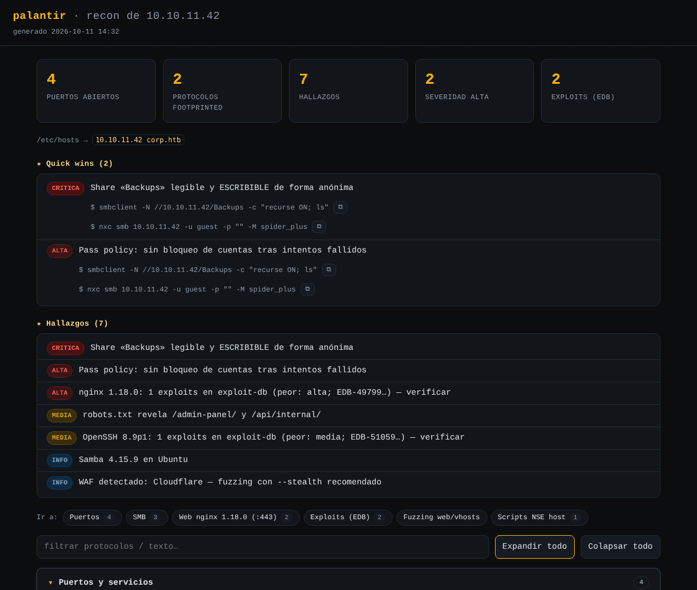

# palantir

[](https://github.com/salitress/palantir/actions/workflows/selftest.yml)
[](LICENSE)
[](README.es.md)

**Nmap-driven recon scanner for authorized labs and engagements (OSCP / CPTS / HTB).**
Ports, service fingerprinting, **per-protocol footprinting**, **known-exploit
lookup** and web surface — before you touch anything. Single Python 3 file,
**stdlib-only core**; every external tool is **optional** and skipped
gracefully if missing.

> **Heads up:** the tool's own output — CLI messages, the HTML/Markdown
> report, every code comment — is in **Spanish**. That's intentional (it's
> where this project started), not a bug. This README is in English so the
> project is discoverable; for the full, most detailed write-up in Spanish,
> see **[README.es.md](README.es.md)**.

## Contents

[Preview](#preview) · [Why](#why) · [Quick start](#quick-start) ·
[What it does](#what-it-does) · [Requirements](#requirements) ·
[Usage](#usage) · [Flags](#flags) · [Pivoting / tunneling](#pivoting--tunneling) ·
[Notes](#notes) · [Safe for exam use](#safe-for-exam-use)

## Preview



*Illustrative example (synthetic data, generated for this README) — this is
what `report.html` looks like after a real scan: summary cards up top,
**★ Quick wins** with a copy button on every command, findings sorted by
severity, and a **"Jump to:"** index into every protocol section.*

## Why

Most recon workflows for OSCP/CPTS-style labs end up as a pile of one-off
`nmap`/`nxc`/`ffuf` commands copy-pasted from a cheat sheet, re-typed for
every box. `palantir` automates the *safe, read-only* part of that
workflow — discovery, fingerprinting, default-credential checks, known-exploit
lookup, web fuzzing — and stops exactly where exploitation starts, leaving
every "next step" as an explicit, ready-to-copy command instead of running it
for you. See [Safe for exam use](#safe-for-exam-use) for why that boundary is
drawn where it is.

## Quick start

```bash
sudo ./palantir.py 10.129.21.27          # full recon by default (see "What it does" below)
```

The flags you'll actually reach for day to day (full table in [Flags](#flags)):

| Flag | What it's for |
|---|---|
| `target` | IP, CIDR, range or hostname — the only required argument. |
| `sudo` | SYN scan (`-sS`) + UDP. Without root, falls back to connect scan (`-sT`), slower. |
| `--top` | Top-1000 ports instead of all 65535 — much faster for a first pass. |
| `--no-aggressive` | Skip `vuln` NSE scripts and deep footprinting — faster, quieter. |
| `--stealth` | Slower, quieter timing — for evasion-focused labs. |
| `--tunnel` (`--pivoting`) | Scan through a pivot/tunnel (ligolo-ng, chisel, SOCKS...): `-sT` + timing tuned not to flood the relay (no `--min-rate`, more retries) so you don't silently lose open ports. Much faster than `--stealth`. |
| `--resume` | Reuses the existing nmap scan and, if ports didn't change, the previous footprint/searchsploit/default-creds results too (not repeated) — only reruns fuzzing/reports and any newly provided credentials. For fast iteration. |
| `--vhost DOMAIN` / `--vhost-names LIST` | Vhost fuzzing, or go straight to confirming ones you already know. |
| `--port PORTS` | When you already know the port (e.g. an HTB Academy lab) — skips the full sweep. |
| `--default-creds` | **Only** verified default credentials, nothing else — fast and targeted. |
| `--jobs N` | Multiple targets in parallel (a `/24`, a large list). |
| `-o DIR` | Output folder (default `~/htb`). |
| `--selftest` | Runs the tool's own test suite without touching the network. |

More copy-paste examples in [Usage](#usage).

## What it does

0. **Ping sweep** (CIDR/ranges, `nmap -sn`, one process) — checks who's alive
   first and drops dead hosts from the rest of the run (a /24 with 50 live
   hosts saves 200 full `-p-` sweeps against dead ones). Only prunes IPs that
   came from a CIDR/range; a single IP or hostname is always scanned as given
   (an HTB box often doesn't answer ping, hence `-Pn` for the rest).
   Auto-disabled under `--tunnel` (ICMP doesn't cross most pivots).
1. **Port discovery** — full `-p- --min-rate --max-retries 2 --open` sweep
   (top-1000 with `--top`).
2. **Enumeration** — `-sV` + a curated list of **safe** NSE scripts on open
   ports. With `--aggressive`, a **second, separate** nmap run adds
   `vuln`/backdoor scripts (heartbleed, ms17-010, shellshock...) so a hang in
   one of those never costs you the safe results.
3. **UDP** (optional, `--udp`, needs root) — the UDP ports that matter (SNMP,
   TFTP, NTP, IPMI, DNS...), right after enumeration so SNMP/IPMI are already
   known when footprinting starts.
4. **Manual banner grabbing** — a raw socket probe against every open port,
   catching services nmap left as `unknown`.
5. **Per-protocol footprinting** — read-only + default credentials only (one
   attempt per account, never brute force), each command printed with its
   *why*. See the table below; full detail in [README.es.md](README.es.md).
5b. **Known exploits** (`searchsploit`, offline) per detected product+version.
5c. **Verified default credentials** — a curated, per-service list, each
    confirmed with a real read operation, not just "it connected".
5d. **Provided-credential reuse** — with `--user`/`--pass`, `--user-list`/
    `--pass-list`, `--hash` (pass-the-hash) or `--creds-file`, reuses the
    credential(s) against every detected service, and — the actual point of
    giving palantir a credential — **enumerates the domain with it** (shares,
    users, groups, password policy, AS-REP/Kerberoasting, LAPS, AD CS, DCSync
    rights...) rather than just confirming the login works.
6. **Web fuzzing** (`ffuf`) — directories/files with extensions guessed from
   the server (IIS → `asp,aspx,...`; PHP → `php`; Tomcat → `jsp`). Multiple
   web ports fuzz in parallel.
7. **Vhost / subdomain fuzzing** — domain auto-discovered from certs/
   redirects/SMB, or forced with `--vhost`; `crt.sh`/passive-DNS hits are
   tried before the big wordlist.
7b. **Per-vhost directory fuzzing** — each confirmed vhost gets its own
    directory tree fuzzed (capped at 6 vhosts).
8. **Reports** — `report.html`, `report.md`, `findings.json`, written
   **before** fuzzing starts (auto-refreshing, growing as fuzzing finds
   things) and again, final, once everything completes — even on `Ctrl-C` or
   a crash mid-fuzz, you never end up without a report.

| Protocol / port | What happens |
|---|---|
| FTP | Anonymous login + listing; **mod_copy** (CVE-2015-3306, read-only) and **FTP bounce** checks. |
| SMB / RPC | Null-session enum (incl. group membership via SAMR), `nxc` with a default-credential fallback, readable-share spidering; **Zerologon**, **SMB signing not required** (→ reflective-relay finding if MSRPC coercion is also present), full AD enum if it's a DC and a session gets in. With a credential (5d): `--loggedon-users`, GPP cpassword, **noPac**. |
| LDAP | `nxc` fallback + `ldapsearch` naming contexts/**trusts**/**MachineAccountQuota**. With a credential (5d): users/groups/roasting + **LAPS** + `certipy find` (AD CS) + **DCSync-rights** + **adidnsdump**. |
| WinRM / RDP / VNC / WMI | `nxc` with default-credential fallback. |
| MSSQL | `nxc` with `sa`/no password → `xp_cmdshell`. |
| NFS | `showmount` + `nxc nfs --shares`. |
| DNS | AXFR + `dig any`; WHOIS, Certificate Transparency (`crt.sh`), passive DNS if a domain is known. |
| Kerberos / Docker API | Confirms DC + **Kerberos pre-auth user enum** (`kerbrute userenum`, no lockout risk) if a domain is known, plus automatic **password spraying** with `--spray PASS`; unauthenticated Docker API → trivial RCE. |
| SMTP / IMAP / POP3 / SSH | User enum/open relay, banners, next steps. |
| SNMP | `snmpwalk` + a targeted walk of juicy OIDs; community brute force with `--aggressive`. |
| Web / IIS | `whatweb`+`wafw00f`+sensitive-file checks+missing security headers; `--nikto`/`--cms-scan`/`--crawl`/`--nuclei` opt-in. |
| MySQL / PostgreSQL / Oracle / IPMI / Redis / rsync | NSE + next steps. |
| Elasticsearch / CouchDB / Memcached | Unauthenticated-access checks. |
| AJP / RMI / MongoDB / Telnet / TFTP / NTP | Next-step suggestions / NSE. |
| Finger / IPP-CUPS / X11 / git daemon | Unauthenticated user enum / CUPS version / open `xhost +` display / clonable exported repos. |

## Requirements

- **Core:** `python3` and **nmap** (required). Everything else is optional
  and auto-detected.
- **Recommended on Kali:** `ffuf` + `seclists`, `exploitdb` (`searchsploit`),
  `netexec` (`nxc`), `smbclient`/`rpcclient`/`smbmap`/`enum4linux-ng`,
  `impacket-scripts`, `nfs-common`, `dnsutils`, `whois`, `ldap-utils`,
  `whatweb`, `wafw00f`, `snmp`/`onesixtyone`, `tnscmd10g`, `redis-tools`.
  For verified default credentials: DB clients for MySQL/PostgreSQL, `odat`,
  `ipmitool`, and (manual install) `mongosh`.
- **Not in apt** (installed on demand with `--install-missing`, which always
  names the exact source before downloading anything): `certipy-ad`,
  `adidnsdump` (pip/pipx), `kerbrute` and `crt.sh` (precompiled GitHub release
  binaries), `jsmith.txt` (realistic AD username wordlist). `joomscan` and
  `mongosh` stay manual-install (too environment-dependent to automate
  confidently).
- Run as **root** for SYN scan + UDP; without root it falls back to connect
  scan.

Full install notes and exact package names: [README.es.md](README.es.md#requisitos).

## Usage

```bash
chmod +x palantir.py

# Full recon by default (recommended with sudo): scan + vuln scripts +
# deep footprint + default creds + searchsploit + fuzzing + UDP (if root) + HTML
sudo ./palantir.py 10.129.21.27

# Faster/quieter: no vuln scripts, no deep footprint, no UDP
sudo ./palantir.py 10.129.21.27 --no-aggressive --no-udp

# Known domain: big wordlist profile + vhost/AXFR
sudo ./palantir.py 10.129.21.27 --profile big --vhost inlanefreight.htb

# Scan + footprint only, no fuzzing or reports
./palantir.py 10.129.21.27 --no-fuzz --no-html

# ONLY verified default credentials, every service
sudo ./palantir.py 10.129.21.27 --default-creds

# Multi-target: CIDR, range, list or file (+ add hosts to /etc/hosts without asking)
sudo ./palantir.py 10.129.21.0/24 --add-hosts
sudo ./palantir.py "10.129.21.27, 10.129.21.40, target.htb" --top
sudo ./palantir.py --targets targets.txt

# Several targets IN PARALLEL (e.g. a /24, 4 at a time; [ip]-tagged output)
sudo ./palantir.py 10.129.21.0/24 --jobs 4

# Stealth lab: slow/fragmented nmap + delayed ffuf, through Burp
sudo ./palantir.py 10.129.21.27 --stealth --proxy http://127.0.0.1:8080

# Firewall that trusts a specific port (e.g. 53/DNS)
sudo ./palantir.py 172.16.119.7 --tunnel   # through a pivot (ligolo-ng/chisel/SOCKS): doesn't lose ports
sudo ./palantir.py 10.129.21.27 --source-port 53

# Known port (HTB Academy "Virtual Hosts" lab: skip sweeping all 65535 ports)
sudo ./palantir.py 10.129.21.27 --port 38490 --vhost inlanefreight.htb

# Already-known vhosts (the lab gives you the names): straight to fingerprinting
sudo ./palantir.py 10.129.21.27 --vhost-names app.inlanefreight.local,dev.inlanefreight.local

# Reuse a credential against EVERY service (phase 5d), without rescanning
sudo ./palantir.py 10.129.21.27 --resume --user svc_admin --pass Passw0rd!
sudo ./palantir.py 10.129.21.27 --resume -U users.txt -P passwords.txt   # crosses both lists (real spraying)

# Valid domain credential: enumerate WITH it (shares/users/groups/kerberoasting) + content spidering
sudo ./palantir.py 10.129.234.121 --resume -u mendres -p 'Inlanefreight2025!' --spider
# Pass-the-hash with an NTLM hash (no password)
sudo ./palantir.py 10.129.21.27 --resume -u Administrator -H 31d6cfe0d16ae931b73c59d7e0c089c0 --local-auth

# Internal test of the parsers and HTML generator (no network)
./palantir.py --selftest
```

## Flags

The full, exhaustively-documented flag table lives in
**[README.es.md](README.es.md#flags)** (every flag, what it defaults to, and
why). The short version is in [Quick start](#quick-start) above; run
`./palantir.py -h` for the authoritative list.

## Pivoting / tunneling

`--tunnel` (alias `--pivoting`/`--pivot`) tunes the scan for going through a
pivot (ligolo-ng, chisel, sshuttle, `ssh -D`, SOCKS/proxychains, Meterpreter,
WSL2+VPN...): forces connect scan (`-sT`), drops `--min-rate` and raises
`--max-retries` to 10 so nmap's own congestion control — not a fixed rate —
decides the pace through a relay that would otherwise mark **open** ports as
`filtered`. It keeps the full `-p-` sweep (confirmed live: ligolo-ng finds
both 3389 and 5985 this way) and disables the Fase 0 ping sweep automatically
(ICMP rarely crosses a pivot). **It only tunes the scan, it doesn't route
anything** — a route-based pivot (ligolo-ng, sshuttle) needs nothing else; a
SOCKS-only pivot (chisel, `ssh -D`) needs the whole invocation wrapped in
`proxychains`. Full breakdown by tunnel type, what survives each one, and
measured timings: [README.es.md](README.es.md#modo-pivoting--túnel).

## Notes

- Targets are validated before being handed to nmap (no traversal/option
  injection). Multi-target runs go sequential by default, `--jobs N` runs up
  to N in parallel.
- **Pre-flight tool check**: if something required by your flags is missing,
  it's reported once (with where it'd be installed from) and you choose
  install/continue-without-it/abort; `--install-missing` skips the prompt.
- Everything runs by default (`--no-*` opts out); `--default-creds` does the
  opposite — only that phase.
- `--resume` reuses existing nmap XML and, when ports/services are identical
  to the previous run, the footprint/searchsploit/default-creds results too
  — provided credentials (phase 5d) are the one phase that **never** gets
  skipped, since that's usually the whole reason you're re-running.
- `searchsploit` is an **offline** lookup against a local exploit-db copy —
  it never downloads or executes anything; always verify a match by hand.
- `~/.palantirrc` holds default flags (one or more per line, `#` comments),
  prepended to the CLI args (the command line always wins).

Full, line-by-line notes (every edge case, every "why"): [README.es.md](README.es.md#notas).

## Safe for exam use

By default `palantir` is pure enumeration — nmap/ffuf/footprinting/default
credentials — **nothing is auto-exploited**, so it doesn't conflict with
exam policies that ban automated exploitation (the kind that rules out
Nessus/OpenVAS/Metasploit `autopwn`/sqlmap, none of which this tool uses or
wraps). The one flag worth double-checking before an exam is **`--nuclei`**
(opt-in, off by default): some community templates don't just detect, they
run a full PoC.

The automatic SAM/LSA dump after a confirmed SMB admin session, `certipy
find`, and the noPac/DCSync-rights *checks* are not exploitation either —
they read what a credential **you already provided** is already allowed to
read, or merely confirm a vulnerability exists (same category as
`secretsdump.py`/crackmapexec run by hand). Anything that *would* be an
active escalation — requesting or forging a certificate, actually
impersonating via noPac, a full NTDS dump — is always left as an explicit
manual next step, never chained automatically. See
[README.es.md](README.es.md#notas) for the exact reasoning behind each one.

## Contributing

See [CONTRIBUTING.md](CONTRIBUTING.md) for the code layout and how to add a
new protocol. [CHANGELOG.md](CHANGELOG.md) has the project history.

## License

[MIT](LICENSE).

**Use only against targets you're explicitly authorized to test** (HTB/CPTS
labs, engagements with written permission).
